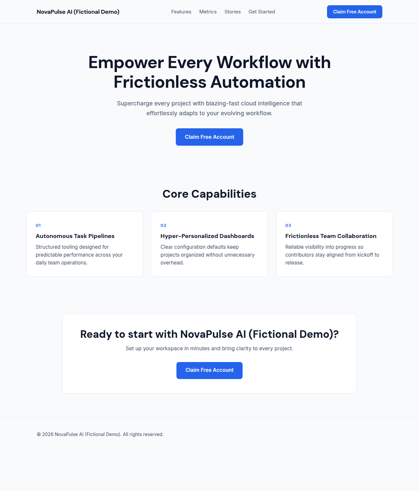
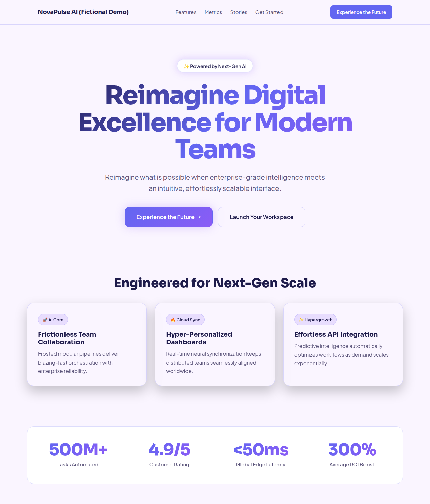
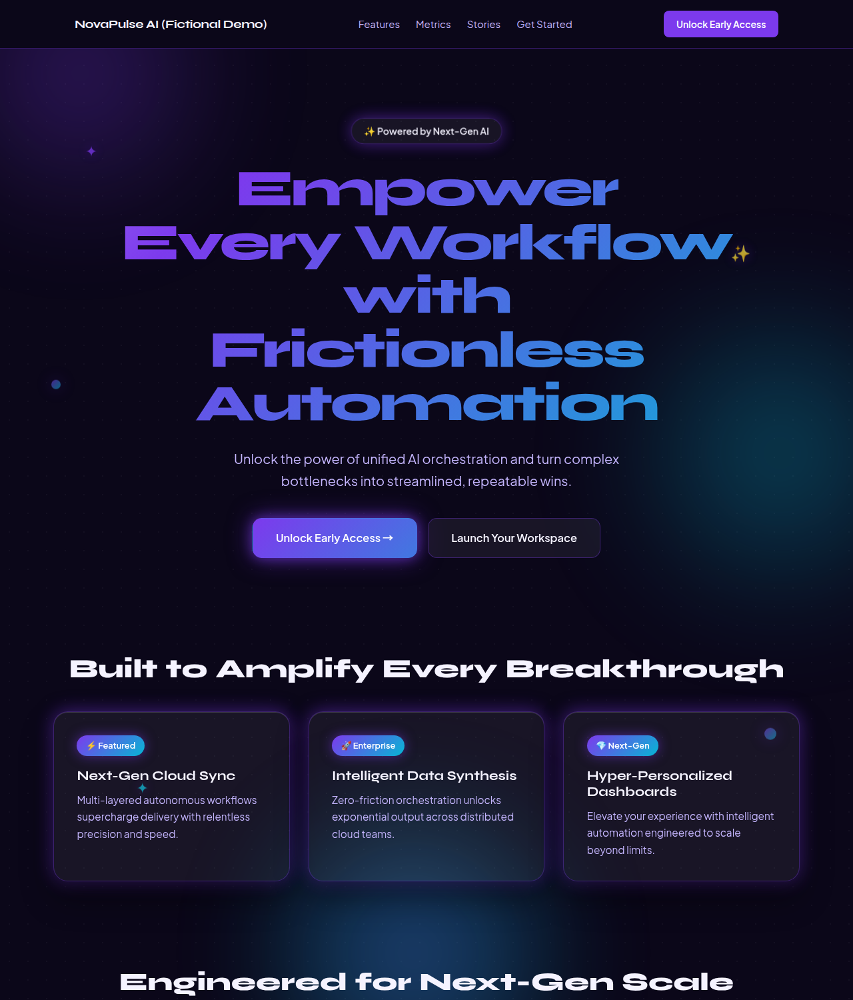

# slop-skill

<p>
  <a href="README.md"></a>
</p>

> **정밀하게 설계된 통계적 평범함.**  
> 원하는 강도의 AI slop을 재현 가능하게 제조하는 스위스 모더니즘급 디자인 시스템.

시중의 거의 모든 프론트엔드 에이전트 스킬은 AI slop을 *치료*하겠다고 약속합니다. 보라색에서 파란색으로 이어지는 그라디언트, 반투명 글래스모피즘 카드, 떠다니는 로켓 이모지, 그리고 "워크플로우를 혁신하세요"라는 숨 가쁜 문구를 박멸하는 것이 목표입니다.

`slop-skill`은 반대로 훨씬 절제된 질문을 던집니다. **만약 규격에 맞춰 정교하게 설계된 슬롭이 필요하다면 어떨까요?**

언어 모델이 우연히 평범한 결과물로 흘러가게 두는 대신, `slop-skill`은 2022–2025년형 LLM SaaS 랜딩 페이지의 전형적인 클리셰를 결정론적이고 스키마로 검증된 5단계 디자인 시스템으로 체계화했습니다. 다이얼을 **Level 1**에 두면 얌전한 스타트업 템플릿 수준으로 절제되고, **Level 5**까지 끝까지 돌리면 짙은 다크 네온 보이드, 둥둥 떠다니는 방사형 블롭, `10K+ Active Users`, 그리고 가상의 엔지니어링 부사장이 남긴 별점 5점짜리 후기까지 완벽하게 재현합니다.

---

## 1. 프로젝트 개요 및 핵심 테제

AI slop은 단순히 깨진 HTML이 아닙니다. 어긋난 여백과 투박한 기본 폰트는 성급하게 만든 사람의 작업물처럼 보입니다. 진짜 AI slop은 **과도하게 매끈한 통계적 평범함**입니다. 수만 개의 Tailwind UI 키트를 평균 냈을 때 나타나는, 모든 요소가 중앙에 정렬된 수직 스택의 묘한 동질감입니다.

`Inter` + `Poppins` 조합이나 `backdrop-filter: blur(16px)` 카드, `Get Started Free` 버튼 하나만 떼어 놓으면 그럴듯해 보입니다. 사람들이 "이거 AI가 만들었네"라고 즉각 눈치채는 순간은 이 요소들이 **동시에 겹쳐 나타날 때**입니다. `slop-skill`은 이 동시 출현 패턴을 명시적인 강도 파라미터(`level: 1..5`)로 모델링하고, 시드 기반 PRNG 딜러, 슬롯 격리형 HTML 어셈블러, 그리고 결과물을 0~100점으로 측정하는 자동 **Slop Meter** 린터로 완성했습니다.

---

## 2. 주요 기능

- **시드 기반 결정론적 디자인 딜링:** Mulberry32 PRNG를 직접 구현해 동일한 `--level`, `--seed`, `--page`, `--brand` 입력에 대해 바이트 단위로 동일한 JSON 디자인 명세를 반환합니다.
- **5단계 슬롭 강도 다이얼:** `Level 1`(*Subtle Slop*)부터 `Level 5`(*Peak Transcendent Slop*)까지 팔레트, 타이포그래피, 컴포넌트 개수, 애니메이션 스택, 버즈워드 밀도를 단계별로 확장합니다.
- **외부 의존성 없는 Node.js 22+ ESM CLI:** `node_modules`와 빌드 단계 없이 표준 Node.js(`>= 22.0.0`)만으로 즉시 실행되며, 유닉스 파이프라인(`stdin`/`stdout`)으로 조합할 수 있습니다.
- **34개 규칙의 Slop Meter:** 모든 HTML 문서를 5개 카테고리(`color`, `typography`, `layout`, `effect`, `copy`) 기준으로 평가해 가중치 점수, 등급, `--json` 리포트, `--min` 기준치 종료 코드를 제공합니다.
- **Agent Skills & Claude Plugin 패키징:** `npx skills`, Claude Code 플러그인 마켓플레이스, 또는 안전한 로컬 심볼릭 링크 스크립트(`install.sh`)로 바로 설치할 수 있습니다.

---

## 3. 슬롭 레벨 (1–5)

[docs/CONTRACT.md](docs/CONTRACT.md)에 정의된 5단계 슬롭 강도 규격입니다.

| 레벨 | 명칭 | 컴포넌트 수 | 애니메이션 | 시각 및 구조적 특징 | 예상 Slop Score |
|---:|---|---:|---|---|---|
| 1 | Subtle Slop | 2–3개 | 0개 (`[]`) | 밝고 부드러운 중립 팔레트, 은은한 그라디언트, 기하학 폰트, 깔끔한 중앙 히어로와 카드, 최소 장식 | 0–50 (`Artisanal` / `Mild`) |
| 2 | Mild SaaS | 3–4개 | 0–1개 (선택) | 은은한 인디고/바이올렛 포인트, 듀얼 CTA, 절제된 그림자, 가벼운 마케팅 문구 | 25–60 (`Mild` / `Full Slop`) |
| 3 | Classic AI | 4–5개 | 1개 (`["float"]`) | 보라–파랑 그라디언트, 그라디언트 텍스트 헤드라인, 이모지 3열 카드, 스파클 배지, Float 모션, 전형적 SaaS 클리셰 | 51–80 (`Full Slop`) |
| 4 | Heavy Neon | 6–7개 | 2–3개 (`float`, `pulse`, `hover-scale`) | 다크 보이드 배경, 보라/파랑 네온 글로우, 글래스모피즘 카드, 가짜 통계, 별점 5점 후기, 강한 그림자 | 70–92 (`Full Slop` / `Transcendent`) |
| 5 | Peak Transcendent Slop | 7–10개 | 4–6개 (전체 활성) | 풀 다크 네온 보이드, 다중 그라디언트, 그라디언트 텍스트, 블러 블롭 배경, 떠다니는 장식, 글래스모피즘, 이모지 카드, 과도한 그림자, 가짜 통계, 별점 후기, 뉴스레터 박스, 네온 CTA, 최대 버즈워드 밀도 | 81–100 (`Transcendent`) |

---

## 4. 설치 방법

### Agent Skills CLI (`npx skills`)

```bash
# 레포지토리의 스킬 설치
npx skills add seohuda/slop-skill

# slop-skill 지정 설치 또는 전역 설치
npx skills add seohuda/slop-skill --skill slop-skill
npx skills add seohuda/slop-skill --global
```

### Claude Code 플러그인 마켓플레이스

Claude Code 내부에서 다음 명령을 실행합니다.

```text
/plugin marketplace add seohuda/slop-skill
/plugin install slop-skill@slop-skill
```

### 로컬 심볼릭 링크 설치 (`install.sh`)

```bash
git clone https://github.com/seohuda/slop-skill.git
cd slop-skill
./install.sh
```

기본적으로 `install.sh`는 `skills/slop-skill` 디렉터리를 `${CLAUDE_SKILLS_DIR:-$HOME/.claude/skills}/slop-skill`에 심볼릭 링크로 연결합니다. 대상 경로에 이미 다른 파일이나 디렉터리가 존재할 경우 `--force` 옵션 없이는 덮어쓰지 않고 안전하게 중단합니다.

주요 옵션:

```bash
./install.sh --dry-run                 # 실제 디스크 변경 없이 수행 예정 작업 미리보기
./install.sh --target /custom/skills   # 사용자 지정 경로에 설치
./install.sh --force                   # 기존 경로가 있더라도 강제로 교체
```

---

## 5. 사용법

### AI 에이전트 스킬로 사용하기

설치 후 코딩 에이전트에게 한국어 또는 영어로 원하는 슬롭 강도를 요청하세요(미지정 시 기본 Level 3 적용):

- **한국어 트리거 예시:**
  - `"AI slop 디자인을 만들어줘"`
  - `"일부러 AI스럽게 만들어줘"`
  - `"전형적인 AI 랜딩페이지 만들어줘"`
  - `"슬롭 강도 5로 디자인해줘"`
  - `"일부러 ChatGPT가 만든 것처럼 만들어줘"`
- **영어 트리거 예시:**
  - `"Make this look like AI slop"`
  - `"Build a Level 4 AI slop landing page with purple neon and glassmorphism"`
  - `"Audit index.html with the slop meter and raise it to at least 81"`

### CLI 파이프라인 직접 실행

Level 5 디자인 명세를 생성하고 독립 실행 가능한 HTML로 조립한 뒤 Slop Score를 바로 측정할 수 있습니다.

```bash
node skills/slop-skill/scripts/deal.mjs --level 5 --seed 42 --brand "NovaFlow AI" \
  | node skills/slop-skill/scripts/assemble.mjs --deal - --output out/landing.html

node skills/slop-skill/scripts/slop-meter.mjs out/landing.html --min 81
```

---

## 6. CLI 명령어 레퍼런스

모든 스크립트는 **Node.js >= 22.0.0** 환경에서 동작하며 `npm run`으로도 실행할 수 있습니다.

### `deal.mjs` — 시드 기반 디자인 명세 생성기

```bash
node skills/slop-skill/scripts/deal.mjs --level <1-5> [--seed <integer>] [--page <page>] [--brand <name>] [--library <dir>]
```

- `--level <1-5>`: 슬롭 강도 (기본값 `3`, 범위를 벗어나면 종료 코드 `1`)
- `--seed <integer>`: Mulberry32 PRNG 결정론적 정수 시드 (기본값 `42`)
- `--page <string>`: 페이지 유형 (`landing`, `saas`, `portfolio`, `pricing`; 기본값 `landing`)
- `--brand <string>`: `copy.brand`에 주입할 브랜드명 (기본값 `"NovaFlow AI"`)
- `--library <dir>`: 커스텀 라이브러리 JSON 디렉터리 경로 (선택)

### `assemble.mjs` — 슬롯 기반 HTML/CSS 어셈블러

```bash
node skills/slop-skill/scripts/assemble.mjs --deal <path|-> [--output <path>] [--template <path>] [--css <path>]
```

- `--deal <path|->`: deal JSON 파일 경로, 또는 `-`(또는 생략)로 `stdin` 입력 수신
- `--output <path>`: 출력 HTML 경로 (상위 디렉터리 자동 생성, 생략 시 `stdout` 출력)
- `--template <path>`: 기본 `skills/slop-skill/assets/starter.html`을 대체할 커스텀 템플릿 경로
- `--css <path>`: 기본 `skills/slop-skill/assets/system.css`를 대체할 커스텀 스타일시트 경로

### `slop-meter.mjs` — Slop Score 측정기

```bash
node skills/slop-skill/scripts/slop-meter.mjs <html-file> [--min <0-100>] [--json] [--rules <dir>]
```

- `<html-file>`: 검사할 HTML 파일 경로
- `--min <0-100>`: 최소 요구 점수 (`score < N`이면 종료 코드 `1`, 충족 시 `0`)
- `--json`: 구조화된 JSON 출력 (`{ file, score, grade, matchedWeight, totalWeight, passedCount, totalRules, categories, results }`)
- `--rules <dir>`: 커스텀 규칙 JSON 디렉터리 경로 (선택)

### `npm` 스크립트

```bash
npm test                                  # 전체 node --test 테스트 스위트 실행
npm run deal -- --level 4 --seed 42       # deal.mjs 실행 별칭
npm run assemble -- --deal deal.json      # assemble.mjs 실행 별칭
npm run meter -- out/landing.html         # slop-meter.mjs 실행 별칭
```

---

## 7. 아키텍처 및 도구 구성

`slop-skill`은 **디자인 요소(데이터)**, **선택(PRNG 딜링)**, **조립(슬롯 렌더링)**, **검증(가중치 채점)**을 엄격하게 분리하여 낮은 레벨의 페이지에 Level 5 네온 효과가 의도치 않게 섞이지 않도록 보장합니다.

```text
skills/slop-skill/library/*.json   (팔레트, 폰트, 카피, 컴포넌트 라이브러리)
        │
        ▼
  deal.mjs + lib/prng.mjs          (Mulberry32 시드 기반 가중치 샘플링)
        │  JSON deal 명세
        ▼
  assemble.mjs + assets/           (starter.html 9개 슬롯 + system.css + :root 토큰)
        │  단독 실행 가능한 HTML
        ▼
  slop-meter.mjs + rules/*.json    (34개 regex/count/computed 규칙 → 0~100점)
```

- **9개 표준 템플릿 슬롯:** `head`, `tokens`, `hero`, `features`, `stats`, `testimonials`, `cta`, `footer`, `extra`. 사용하지 않은 `<!-- SLOT:... -->` 주석은 모두 제거되며, 애니메이션 CSS는 `deal.animations`에 명시된 항목만 주입됩니다.
- **허용 애니메이션 6종:** `float`, `pulse`, `blob-drift`, `gradient-shift`, `hover-scale`, `neon-glow-pulse`.
- **상세 기술 문서:**
  - [Anatomy of AI Slop Design (영문)](docs/slop-anatomy.md) — 색상, 타이포그래피, 레이아웃, 시각 효과, 카피라이팅 클리셰 해부
  - [Technical Contract (영문)](docs/CONTRACT.md) — JSON 스키마, CLI 인터페이스, 슬롯 계약, 채점 규칙의 단일 진실 소스

---

## 8. 예제 결과물

아래 3개의 쇼케이스 페이지는 모두 동일한 가상 브랜드 브리프(**NovaPulse AI (Fictional Demo)**)와 결정론적 시드(`--seed 127`)를 사용해 실제 `deal.mjs`와 `assemble.mjs`로 생성하고 `slop-meter.mjs`로 측정한 결과입니다. 스크린샷은 Headless Google Chrome(`1280×1500`)에서 직접 촬영했습니다.

| 레벨 | 명칭 | 팔레트 | 폰트 조합 | 컴포넌트 | 애니메이션 | 실측 Slop Score | 등급 | HTML |
|---:|---|---|---|---:|---|---:|---|---|
| 1 | Subtle Slop | Slate Minimal | DM Sans / Inter | 3개 | 없음 | **19/100** (8/34 규칙) | `Artisanal` | [examples/level-1/index.html](examples/level-1/index.html) |
| 3 | Classic AI | Lavender Mist | Sora / Plus Jakarta Sans | 5개 | `float` | **76/100** (26/34 규칙) | `Full Slop` | [examples/level-3/index.html](examples/level-3/index.html) |
| 5 | Peak Transcendent Slop | Aurora Violet | Syne / Plus Jakarta Sans | 9개 | 전체 6종 | **97/100** (33/34 규칙) | `Transcendent` | [examples/level-5/index.html](examples/level-5/index.html) |

### 시각 비교 (Level 1 → Level 3 → Level 5)

| Level 1 — Subtle Slop (`19/100`, Artisanal) | Level 3 — Classic AI (`76/100`, Full Slop) | Level 5 — Peak Transcendent Slop (`97/100`, Transcendent) |
|---|---|---|
| [](examples/level-1/index.html) | [](examples/level-3/index.html) | [](examples/level-5/index.html) |

로컬에서 동일 예제 재현하기:

```bash
node skills/slop-skill/scripts/deal.mjs --level 5 --seed 127 --page landing --brand "NovaPulse AI (Fictional Demo)" \
  | node skills/slop-skill/scripts/assemble.mjs --deal - --output examples/level-5/index.html

node skills/slop-skill/scripts/slop-meter.mjs examples/level-5/index.html --min 81
```

---

## 9. Slop Score 및 등급 기준

`slop-meter.mjs`는 5개 카테고리(`color`, `typography`, `layout`, `effect`, `copy`)의 34개 가중치 규칙으로 HTML 문서를 검사한 뒤 아래 공식으로 점수를 계산합니다.

```text
Slop Score = Math.round((매칭된 규칙 weight 합 / 전체 규칙 weight 합) * 100)
```

| 점수 구간 | 등급 | 해석 |
|---:|---|---|
| 0–25 | `Artisanal` | 수상할 정도로 사람 손맛이 느껴짐. 통계적 SaaS 수렴이 거의 감지되지 않음. |
| 26–50 | `Mild` | 절제된 기하학 기본값과 얌전한 템플릿 규율. |
| 51–80 | `Full Slop` | 누가 봐도 AI가 만든 전형적인 SaaS 랜딩 페이지 감성. |
| 81–100 | `Transcendent` | 통계적 모드 붕괴의 정점. 모든 네온 글로우와 버즈워드가 완벽한 화음으로 폭발함. |

---

## 10. 자주 묻는 질문 (FAQ)

### 왜 일부러 AI slop을 *추가*하나요?
풍자, 벤치마킹, 디자인 시스템 교육, 그리고 슬롭 탐지 휴리스틱 테스트 때문입니다. 왜 `linear-gradient(135deg, #8B5CF6, #3B82F6)`과 `10K+ Active Users` 조합이 즉각적인 피로감을 유발하는지 시연하거나 린터를 교정하려면 재현 가능한 기준선이 필요합니다.

### 결과물은 항상 동일하게 재현되나요?
네. `deal.mjs`에 동일한 `--level`, `--seed`, `--page`, `--brand`, `--library`를 전달하면 Mulberry32 PRNG를 통해 바이트 단위로 동일한 JSON이 생성되며, `assemble.mjs`도 결정론적인 HTML을 출력합니다.

### 왜 외부 런타임 의존성이 0개인가요?
과잉 엔지니어링된 보일러플레이트를 풍자하는 도구가 CSS 템플릿 문자열 하나 만들자고 400개의 npm 패키지를 끌고 와서는 안 되기 때문입니다. 표준 Node.js `>= 22.0.0` ESM만으로 완전히 동작합니다.

### `slop-meter.mjs`를 반대로 프로덕션에서 *슬롭을 막는 용도*로 써도 되나요?
물론입니다. CI에서 `slop-meter.mjs dist/index.html --json`을 실행하고 프로덕션 랜딩 페이지가 `Artisanal`(`0–25`) 구간에 머무르는지 검증할 수 있습니다.

### 로컬 심볼릭 링크 설치를 제거하려면 어떻게 하나요?
`install.sh`가 생성한 심볼릭 링크를 삭제하면 됩니다.

```bash
rm "${CLAUDE_SKILLS_DIR:-$HOME/.claude/skills}/slop-skill"
```

---

## 11. 라이선스

[MIT](LICENSE)
