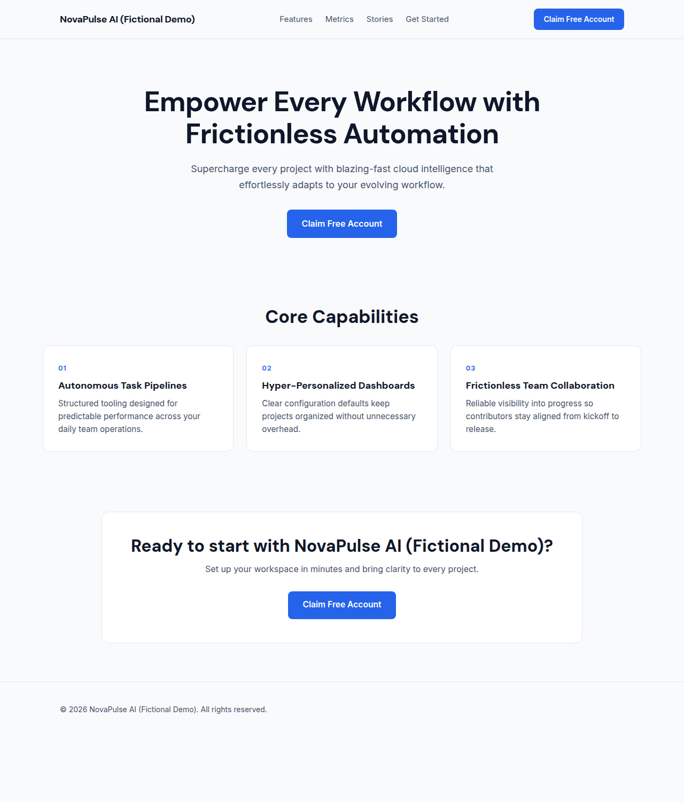
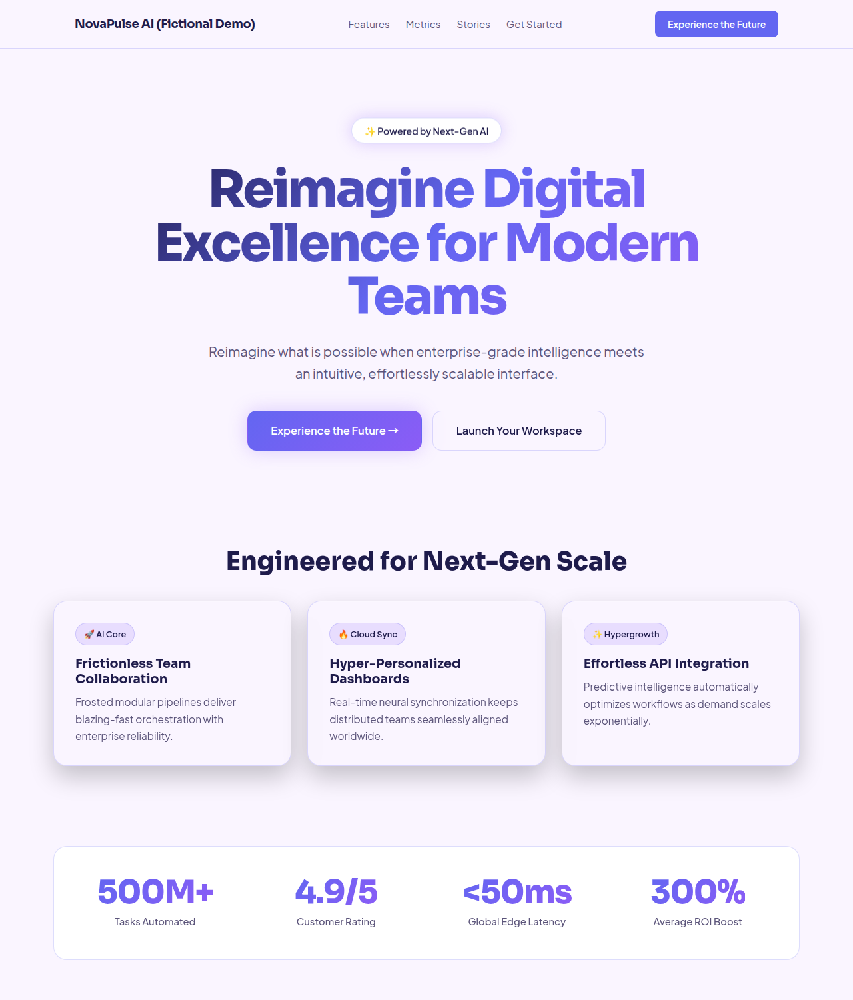
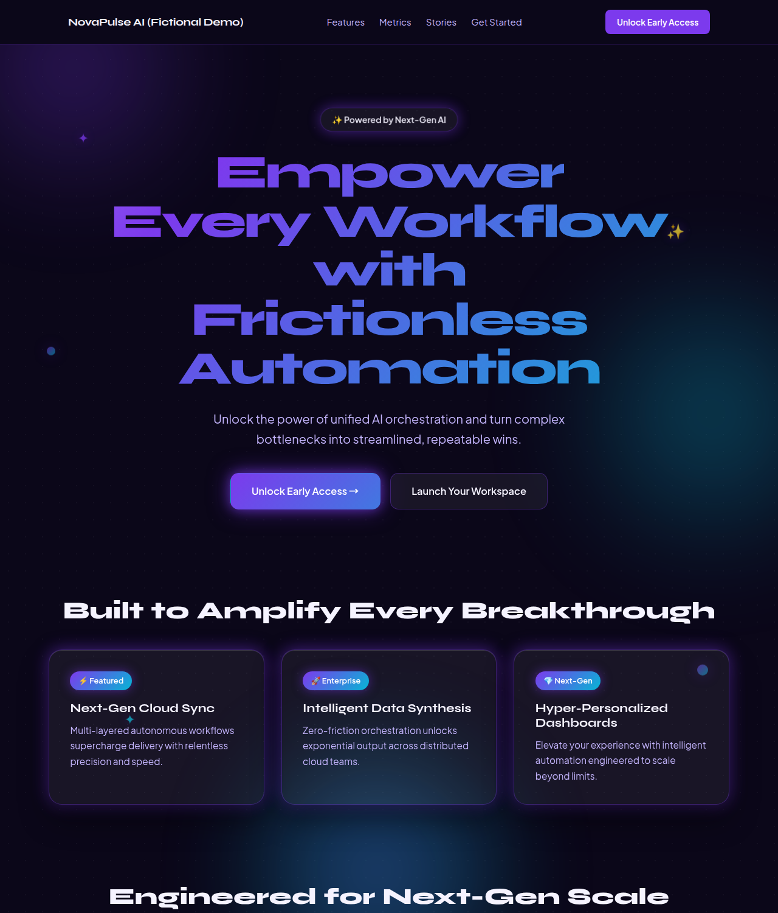

# slop-skill

<p>
  <a href="README.ko.md"></a>
</p>

> **Precision-Engineered Statistical Mediocrity.**  
> A Swiss-modernist design system for manufacturing calibrated, reproducible AI slop on demand.

Every frontend agent skill on the market promises to *cure* AI slop—banishing purple-to-blue gradients, frosted glass cards, floating rocket emojis, and breathless claims about revolutionizing your workflow.

`slop-skill` asks a more disciplined question: **what if you want the slop, engineered to specification?**

Instead of letting a language model drift into accidental mediocrity, `slop-skill` formalizes the canonical tropes of 2022–2025 LLM SaaS landing pages into a deterministic, schema-validated, five-level design system. Turn the dial to **Level 1** for polite startup restraint, or crank it to **Level 5** for full dark-void purple neon, drifting radial blobs, `10K+ Active Users`, and five-star testimonials from fictional VPs of Engineering.

---

## 1. Project Overview & Thesis

AI slop is not broken HTML. Broken margins and mismatched system fonts read as hurried human work. True AI slop is **hyper-polished statistical mediocrity**: the unmistakable visual convergence that appears when a model averages ten thousand Tailwind UI kits into a single centered vertical stack.

Any single trope—an `Inter` + `Poppins` pairing, a `backdrop-filter: blur(16px)` card, a `Get Started Free` button—can survive in isolation. Recognition happens at **co-occurrence**. `slop-skill` models that co-occurrence as an explicit parameter (`level: 1..5`), backed by a seeded PRNG dealer, a slot-isolated HTML assembler, and an automated **Slop Meter** linter that measures your output on a 0–100 scale.

---

## 2. Key Features

- **Seeded Deterministic Design Dealing:** Uses a Mulberry32 PRNG so identical `--level`, `--seed`, `--page`, and `--brand` inputs produce byte-identical JSON design specs.
- **5-Level Slop Intensity Dial:** Cleanly scales palettes, typography, component count, animation stacks, and buzzword saturation from `Level 1` (*Subtle Slop*) to `Level 5` (*Peak Transcendent Slop*).
- **Zero-Dependency Node.js 22+ ESM CLI:** Runs directly on native Node.js (`>= 22.0.0`) with zero `node_modules`, zero build steps, and composable Unix-style stdio pipelines.
- **30+ Rule Slop Meter:** Evaluates any HTML document across five categories (`color`, `typography`, `layout`, `effect`, `copy`) with weighted scoring, grade classification, `--json` output, and `--min` threshold exit codes.
- **Agent Skills & Claude Plugin Packaging:** Installable via `npx skills`, the Claude Code plugin marketplace, or a safe local symlink script (`install.sh`).

---

## 3. Slop Levels

The five discrete intensity levels defined in [docs/CONTRACT.md](docs/CONTRACT.md):

| Level | Label | Components | Animations | Visual & Structural Profile | Expected Slop Score |
|---:|---|---:|---|---|---|
| 1 | Subtle Slop | 2–3 | 0 (`[]`) | Light/soft neutral palette, subtle gradient, geometric font, clean centered hero & feature cards, minimal clutter | 0–50 (`Artisanal` / `Mild`) |
| 2 | Mild SaaS | 3–4 | 0–1 (optional) | Soft indigo/violet accent hints, dual CTAs, modest elevation shadows, gentle buzzwords | 25–60 (`Mild` / `Full Slop`) |
| 3 | Classic AI | 4–5 | 1 (`["float"]`) | Purple-to-blue gradient, gradient-text headline, emoji 3-column cards, sparkle pill badge, floating motion, SaaS cliché copy | 51–80 (`Full Slop`) |
| 4 | Heavy Neon | 6–7 | 2–3 (`float`, `pulse`, `hover-scale`) | Dark void backdrop, purple/blue neon glow, glassmorphism cards, fake stats, 5-star testimonials, heavy shadows | 70–92 (`Full Slop` / `Transcendent`) |
| 5 | Peak Transcendent Slop | 7–10 | 4–6 (all active) | Full dark neon void, multi-stop gradients, gradient text, blurred blobs, floating decorations, glassmorphism, emoji cards, heavy shadows, fake stats, 5-star testimonials, newsletter box, neon CTA, peak buzzword saturation | 81–100 (`Transcendent`) |

---

## 4. Installation

### Agent Skills CLI (`npx skills`)

```bash
# Add all skills from the repository
npx skills add seohuda/slop-skill

# Target slop-skill explicitly or install globally
npx skills add seohuda/slop-skill --skill slop-skill
npx skills add seohuda/slop-skill --global
```

### Claude Code Plugin Marketplace

Inside Claude Code:

```text
/plugin marketplace add seohuda/slop-skill
/plugin install slop-skill@slop-skill
```

### Local Symlink Install (`install.sh`)

```bash
git clone https://github.com/seohuda/slop-skill.git
cd slop-skill
./install.sh
```

By default, `install.sh` symlinks `skills/slop-skill` into `${CLAUDE_SKILLS_DIR:-$HOME/.claude/skills}/slop-skill`. It refuses to overwrite existing files or conflicting directories unless `--force` is passed.

Useful flags:

```bash
./install.sh --dry-run                 # Preview actions without modifying disk
./install.sh --target /custom/skills   # Install into a custom directory
./install.sh --force                   # Replace an existing path at the target
```

---

## 5. Usage Guide

### As an AI Agent Skill

Once installed, prompt your coding agent in Korean or English and specify your desired Slop Level (or let it default to Level 3):

- **Korean triggers:**
  - `"AI slop 디자인을 만들어줘"`
  - `"일부러 AI스럽게 만들어줘"`
  - `"전형적인 AI 랜딩페이지 만들어줘"`
  - `"슬롭 강도 5로 디자인해줘"`
  - `"일부러 ChatGPT가 만든 것처럼 만들어줘"`
- **English triggers:**
  - `"Make this look like AI slop"`
  - `"Build a Level 4 AI slop landing page with purple neon and glassmorphism"`
  - `"Audit index.html with the slop meter and raise it to at least 81"`

### Direct CLI Pipeline

Generate a Level 5 design deal, assemble it into a self-contained HTML page, and measure the resulting Slop Score in one pipeline:

```bash
node skills/slop-skill/scripts/deal.mjs --level 5 --seed 42 --brand "NovaFlow AI" \
  | node skills/slop-skill/scripts/assemble.mjs --deal - --output out/landing.html

node skills/slop-skill/scripts/slop-meter.mjs out/landing.html --min 81
```

---

## 6. CLI Commands

All scripts require **Node.js >= 22.0.0** and can also be invoked via `npm run`.

### `deal.mjs` — Deterministic Design Spec Generator

```bash
node skills/slop-skill/scripts/deal.mjs --level <1-5> [--seed <integer>] [--page <page>] [--brand <name>] [--library <dir>]
```

- `--level <1-5>`: Slop intensity level (default `3`; exits `1` if invalid or out of range).
- `--seed <integer>`: Deterministic integer seed for the Mulberry32 PRNG (default `42`).
- `--page <string>`: Target page archetype (`landing`, `saas`, `portfolio`, `pricing`; default `landing`).
- `--brand <string>`: Brand name injected into `copy.brand` (default `"NovaFlow AI"`).
- `--library <dir>`: Optional path to custom library JSON directory.

### `assemble.mjs` — Slot-Based HTML/CSS Assembler

```bash
node skills/slop-skill/scripts/assemble.mjs --deal <path|-> [--output <path>] [--template <path>] [--css <path>]
```

- `--deal <path|->`: Path to deal JSON file, or `-` (or omitted) to read JSON from `stdin`.
- `--output <path>`: Destination HTML file path (creates parent directories automatically; defaults to `stdout`).
- `--template <path>`: Optional custom starter HTML template overriding `skills/slop-skill/assets/starter.html`.
- `--css <path>`: Optional custom base stylesheet overriding `skills/slop-skill/assets/system.css`.

### `slop-meter.mjs` — Slop Score Auditor

```bash
node skills/slop-skill/scripts/slop-meter.mjs <html-file> [--min <0-100>] [--json] [--rules <dir>]
```

- `<html-file>`: Target HTML file to inspect.
- `--min <0-100>`: Minimum required Slop Score; exits with code `1` if `score < N`, otherwise `0`.
- `--json`: Emits structured JSON (`{ file, score, grade, matchedWeight, totalWeight, passedCount, totalRules, categories, results }`).
- `--rules <dir>`: Optional directory containing custom rule JSON files.

### `npm` Scripts

```bash
npm test                                  # Runs node --test across the test suite
npm run deal -- --level 4 --seed 42       # Alias for deal.mjs
npm run assemble -- --deal deal.json      # Alias for assemble.mjs
npm run meter -- out/landing.html         # Alias for slop-meter.mjs
```

---

## 7. Architecture & Tooling Overview

`slop-skill` separates **tropes** (data), **selection** (PRNG dealing), **rendering** (slot assembly), and **verification** (weighted scoring) so lower levels never accidentally inherit Level 5 neon effects:

```text
skills/slop-skill/library/*.json   (palettes, fonts, copy, components)
        │
        ▼
  deal.mjs + lib/prng.mjs          (Mulberry32 seeded weighted sampling)
        │  JSON deal spec
        ▼
  assemble.mjs + assets/           (starter.html 9 slots + system.css + :root tokens)
        │  Self-contained HTML
        ▼
  slop-meter.mjs + rules/*.json    (30+ regex/count/computed rules -> Score 0-100)
```

- **9 Canonical Template Slots:** `head`, `tokens`, `hero`, `features`, `stats`, `testimonials`, `cta`, `footer`, and `extra`. Unused `<!-- SLOT:... -->` markers are stripped cleanly, and animations are emitted only when explicitly present in `deal.animations`.
- **6 Allowed Animation IDs:** `float`, `pulse`, `blob-drift`, `gradient-shift`, `hover-scale`, `neon-glow-pulse`.
- **Deep Dive Documents:**
  - [Anatomy of AI Slop Design](docs/slop-anatomy.md) — Taxonomy of color, typography, layout, effect, and copywriting tropes.
  - [Technical Contract](docs/CONTRACT.md) — Single Source of Truth for schemas, CLI flags, slot contracts, and scoring rules.

---

## 8. Examples

All three showcase pages below share the exact same fictional brand brief (**NovaPulse AI (Fictional Demo)**) and deterministic seed (`--seed 127`), generated directly with `deal.mjs` and `assemble.mjs` and audited with `slop-meter.mjs`. Screenshots were captured in headless Google Chrome (`1280×1500`).

| Level | Label | Palette | Font Pairing | Components | Animations | Measured Slop Score | Grade | HTML |
|---:|---|---|---|---:|---|---:|---|---|
| 1 | Subtle Slop | Slate Minimal | DM Sans / Inter | 3 | None | **19/100** (8/34 rules) | `Artisanal` | [examples/level-1/index.html](examples/level-1/index.html) |
| 3 | Classic AI | Lavender Mist | Sora / Plus Jakarta Sans | 5 | `float` | **76/100** (26/34 rules) | `Full Slop` | [examples/level-3/index.html](examples/level-3/index.html) |
| 5 | Peak Transcendent Slop | Aurora Violet | Syne / Plus Jakarta Sans | 9 | All 6 | **97/100** (33/34 rules) | `Transcendent` | [examples/level-5/index.html](examples/level-5/index.html) |

### Visual Comparison (Level 1 → Level 3 → Level 5)

| Level 1 — Subtle Slop (`19/100`, Artisanal) | Level 3 — Classic AI (`76/100`, Full Slop) | Level 5 — Peak Transcendent Slop (`97/100`, Transcendent) |
|---|---|---|
| [](examples/level-1/index.html) | [](examples/level-3/index.html) | [](examples/level-5/index.html) |

Reproduce any showcase page locally:

```bash
node skills/slop-skill/scripts/deal.mjs --level 5 --seed 127 --page landing --brand "NovaPulse AI (Fictional Demo)" \
  | node skills/slop-skill/scripts/assemble.mjs --deal - --output examples/level-5/index.html

node skills/slop-skill/scripts/slop-meter.mjs examples/level-5/index.html --min 81
```

---

## 9. Slop Score & Grading

`slop-meter.mjs` evaluates an HTML document against 30+ weighted rules across five categories (`color`, `typography`, `layout`, `effect`, `copy`) and computes the normalized percentage:

```text
Slop Score = Math.round((matchedWeightSum / totalWeightSum) * 100)
```

| Score Range | Grade | Interpretation |
|---:|---|---|
| 0–25 | `Artisanal` | Suspiciously human. Almost no statistical SaaS convergence detected. |
| 26–50 | `Mild` | Polite template discipline with restrained geometric defaults. |
| 51–80 | `Full Slop` | Unmistakable AI-generated SaaS landing page energy. |
| 81–100 | `Transcendent` | Peak statistical mode-collapse. Every neon glow and buzzword firing in unison. |

---

## 10. FAQ

### Why would anyone intentionally *add* AI slop?
Satire, benchmarking, design-system education, and testing slop-detection heuristics. If you want to calibrate a linter or demonstrate why `linear-gradient(135deg, #8B5CF6, #3B82F6)` plus `10K+ Active Users` triggers instant fatigue, you need a reproducible baseline.

### Is the output deterministic?
Yes. Passing the same `--level`, `--seed`, `--page`, `--brand`, and `--library` to `deal.mjs` produces byte-identical JSON via Mulberry32, and `assemble.mjs` renders deterministic HTML from that spec.

### Why zero runtime dependencies?
An engineering tool mocking over-engineered boilerplate should not pull 400 transitive npm packages to format a CSS template string. Everything runs on standard Node.js `>= 22.0.0` ESM modules.

### Can I use `slop-meter.mjs` in reverse to *keep slop out* of production?
Yes. Run `slop-meter.mjs dist/index.html --json` in CI and assert that your production marketing page stays in the `Artisanal` (`0–25`) band.

### How do I uninstall the local symlink?
Remove the symlink created by `install.sh`:

```bash
rm "${CLAUDE_SKILLS_DIR:-$HOME/.claude/skills}/slop-skill"
```

---

## 11. License

[MIT](LICENSE)
